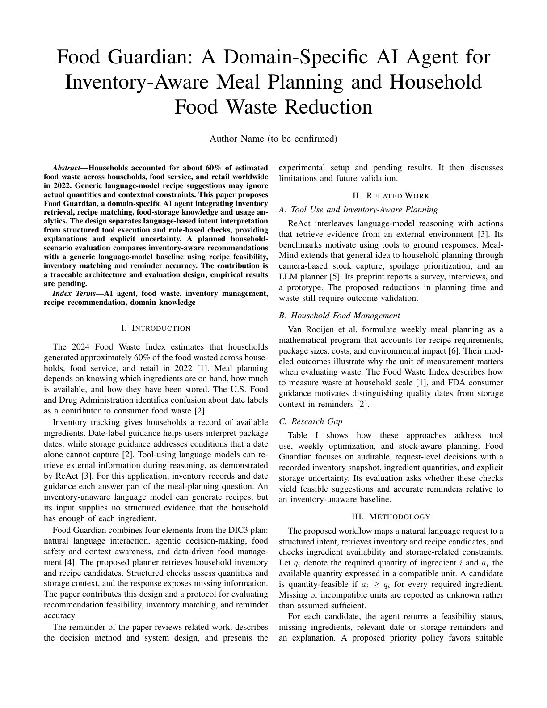
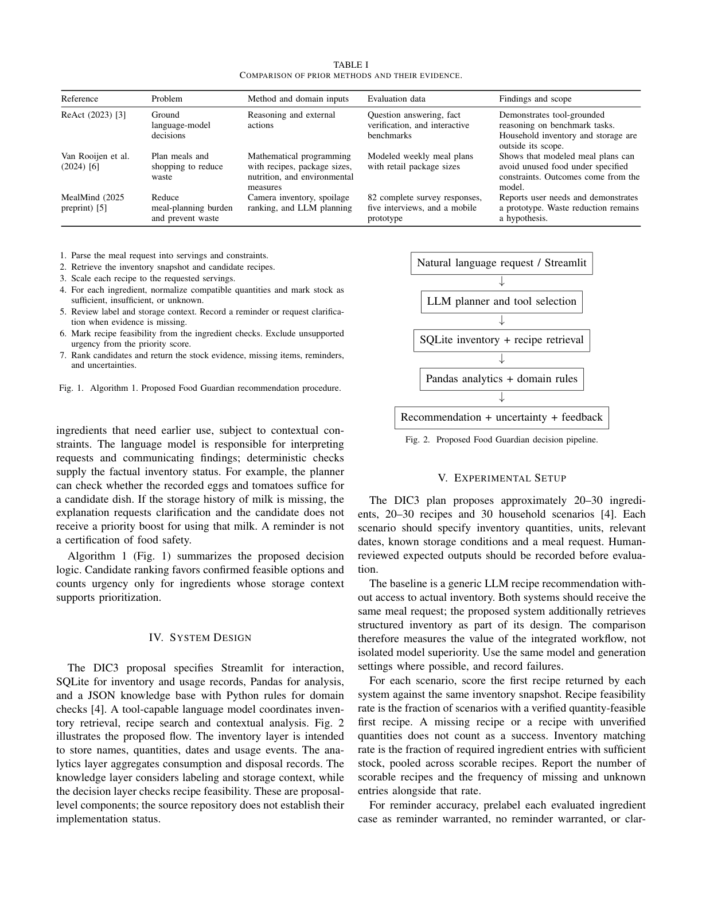
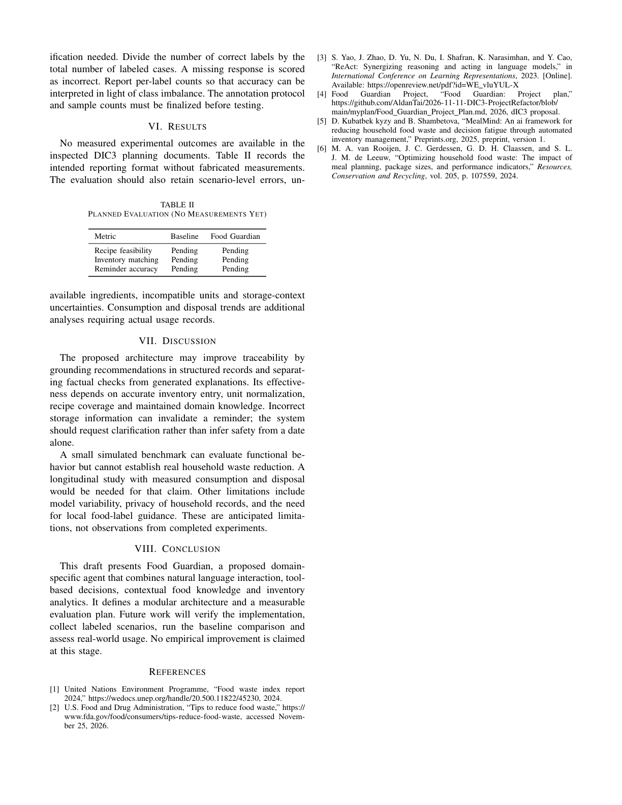
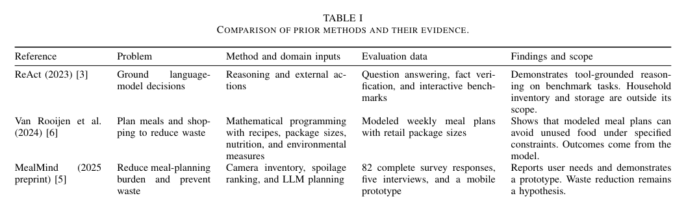
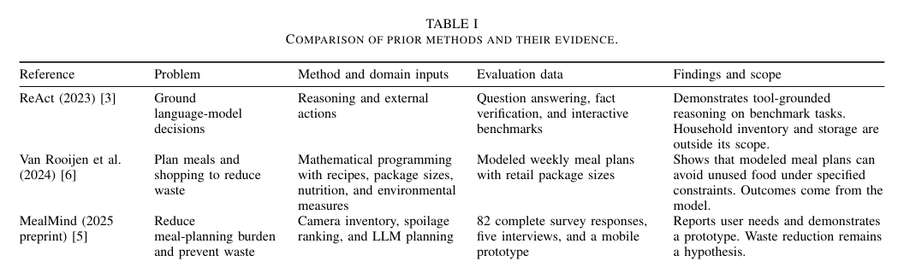
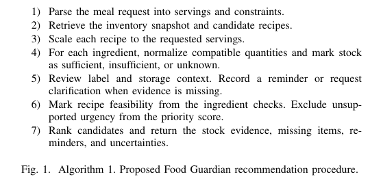
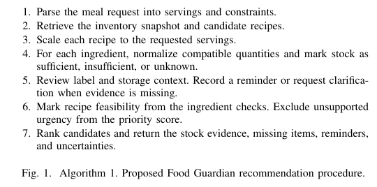

# Food Guardian | DIC4 IEEE Conference Draft

Food Guardian is a proposed domain-specific AI agent for inventory-aware meal planning and household food waste reduction. This draft builds on the DIC3 proposal and evaluates the design at the protocol level. Experimental results are **Pending**.

- [IEEE draft PDF](paper/main.pdf) and [LaTeX entry point](paper/main.tex)
- [OpenSpec changes](openspec/changes), eight passed under strict validation
- [Validation report](validation-report.md)
- [DIC3 source inventory](drafts/source-inventory.md), [citation audit](drafts/citation-audit.md), [abstract checkpoint map](drafts/01-abstract-checkpoint-map.txt), and [introduction citation mapping](drafts/02-introduction-citations.md)

The ten LaTeX section files are loaded from the paper directory. Compile main.tex from that directory. The local verification used Tectonic 0.17.0 with BibTeX. The manuscript uses IEEEtran conference format and the IEEEtran bibliography style. Author details and acknowledgments are pending.

Project-scoped OpenSpec skills are installed for Antigravity. The manuscript was synchronized and compiled with Overleaf Web MCP using pdfLaTeX. See the [Overleaf project](https://www.overleaf.com/project/6b06817e135ce430b62b1cf1) and the [downloaded Overleaf PDF](paper/overleaf-main.pdf).

[DIC4 GitHub repository](https://github.com/AldanTai/2026-11-25-DIC4-Conference)

## IEEE 論文逐頁預覽

以下三頁取自 Overleaf 以 pdfLaTeX 編譯的最新版。可以點擊圖片放大，或[下載完整 PDF](paper/overleaf-main.pdf)。

### 第 1 頁｜研究動機、相關研究與方法

摘要與緒論說明家庭食物浪費的背景，以及只根據文字需求產生食譜時可能忽略的庫存、數量與保存資訊。本頁也介紹相關研究，並定義如何依庫存數量判斷食譜是否可行。

### 第 2 頁｜文獻比較、系統設計與實驗規劃

比較 ReAct、van Rooijen 等人的餐點規劃模型及 MealMind，並呈現 Food Guardian 的七步演算法與系統架構。本頁說明預計如何與不讀取家庭庫存的一般語言模型比較，以及如何評估食譜可行率、庫存匹配率與提醒準確率。

### 第 3 頁｜結果狀態、限制與結論

本頁接續說明提醒準確率的計算方式。結果表中的三項指標均標為 **Pending**。討論與結論說明庫存紀錄、單位換算和保存資訊的限制，以及驗證實際家庭減廢效果所需的長期觀察。頁末列出參考文獻。

## PDF 縮排修正對比

兩欄圖片都取自 Tectonic 編譯的 IEEE PDF。點擊圖片可查看原尺寸，或[下載縮排修正版 PDF](paper/main.pdf)。

| 區域 | 修正前 | 修正後 |
| --- | --- | --- |
| 文獻比較表 | 窄欄雙端對齊，部分文字被拉出明顯的字距空隙。 | 各欄採左對齊，文字從同一左邊界開始，換行靠自然字距排版。 |
| 七步演算法 | 清單沿用文件類別的預設縮排，編號與正文占用較多欄寬。 | 固定編號欄寬與間距，讓每一步的正文與續行對齊，並留出更多正文欄寬。 |

### 文獻比較表

| 修正前 | 修正後 |
| --- | --- |
|  |  |

### 七步演算法

| 修正前 | 修正後 |
| --- | --- |
|  |  |

修正後仍為 3 頁。Tectonic 最終日誌中的行寬不足警告由 **7 則降為 3 則**，未出現超欄或未解析的引用。上方逐頁預覽已更新為同一排版修訂的 Overleaf pdfLaTeX 編譯版。
